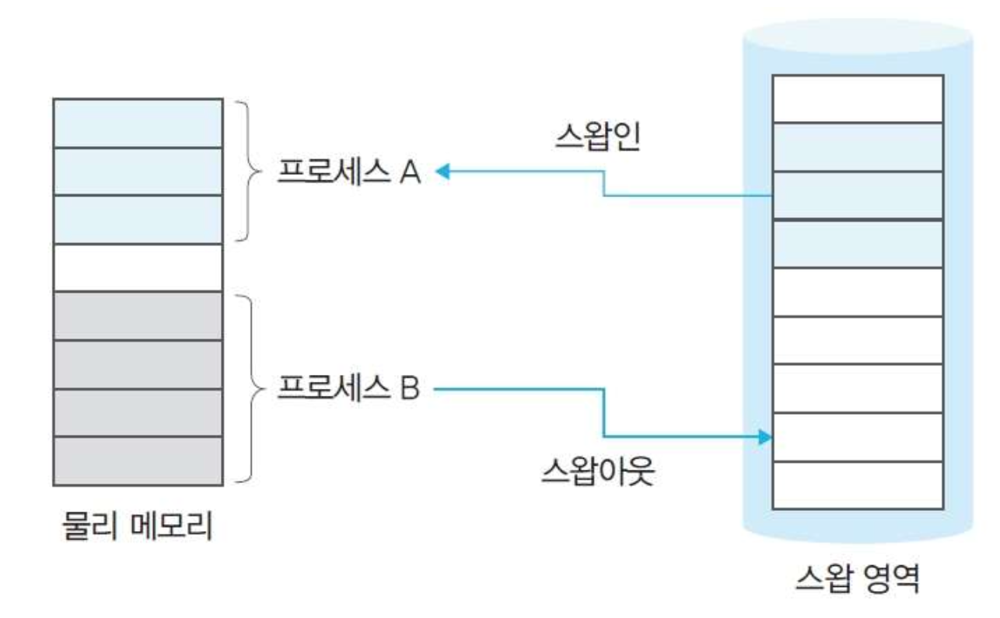
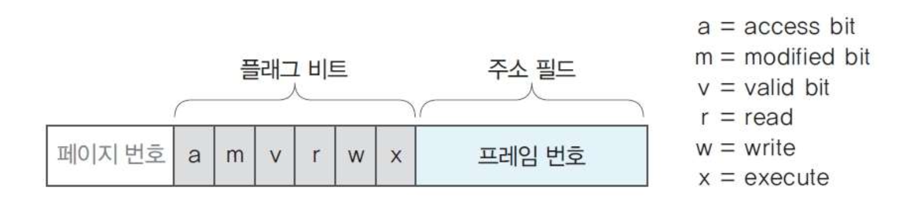
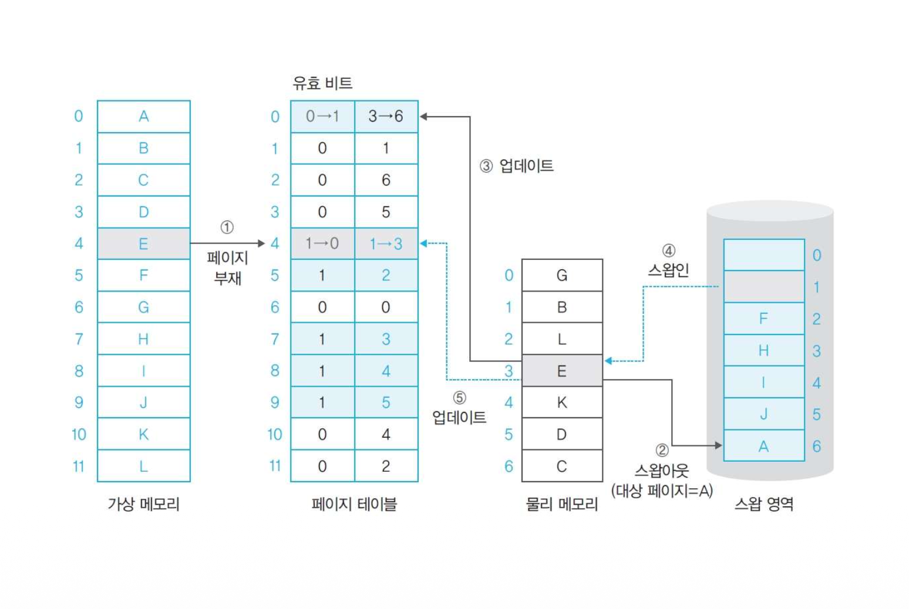
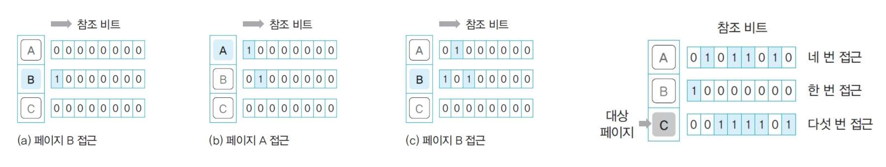
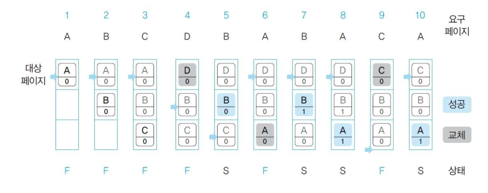
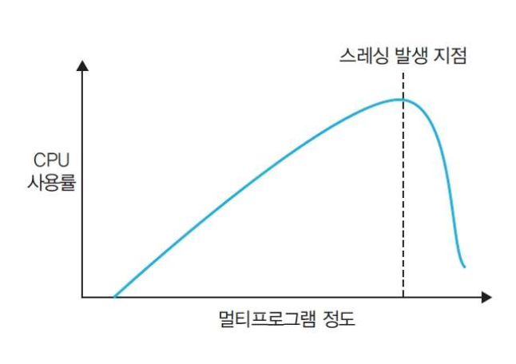
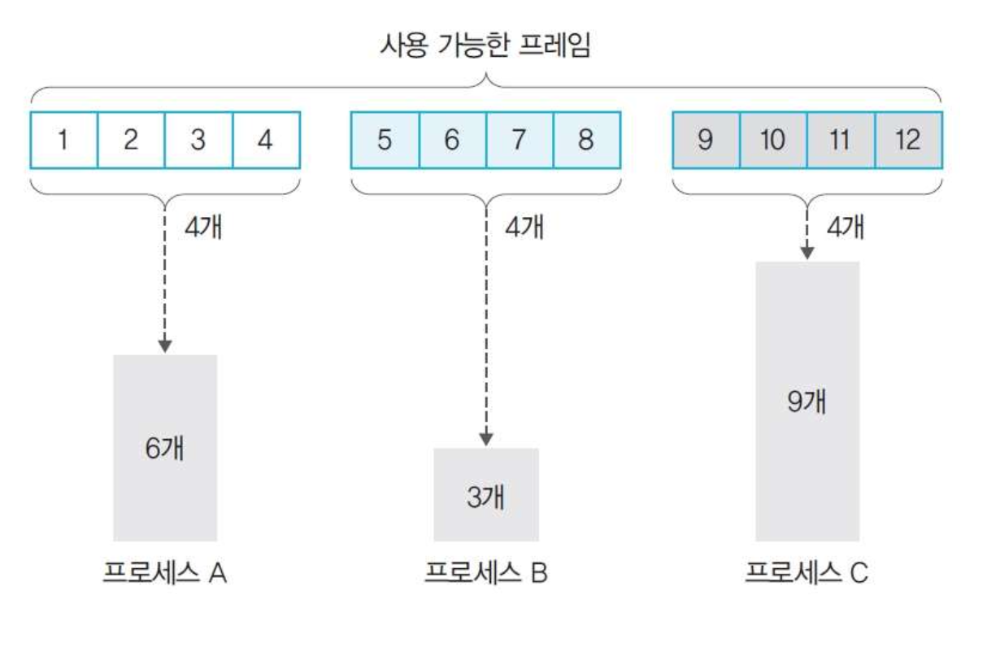
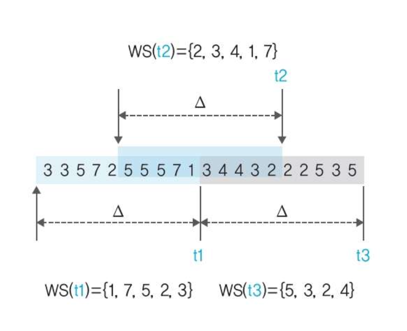
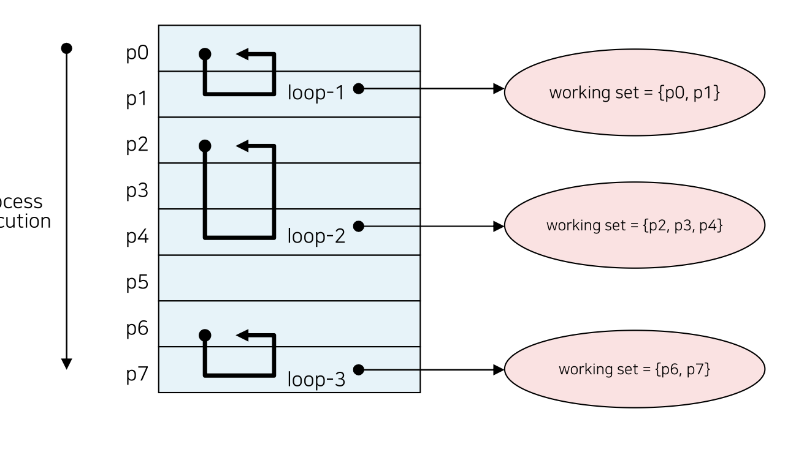
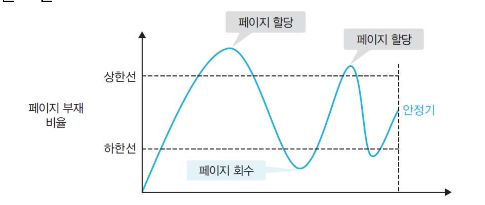

## 요구 페이징
- 요구 페이징(Demand Paging)
	- 프로세스가 요청할 때 페이지를 메모리로 가져오는 것

### 개요
- 운영체제는 프로세스를 구성하는 모듈을 전부 메모리에 올리지 않고 필요한 모듈만 메모리에 올려서 실행함
	- 메모리 공간을 절약할 수 있다.
	- 효율적으로 메모리 관리가 가능해짐. 메모리를 가득 채우면 관리하기 어려우므로 가능한 적은 양만 메모리에 올림
	- 용량이 큰 프로세스를 전부 메모리로 가져오지 않으므로 응답 속도가 향상됨

- 요구 페이징
	- 필요할 때 해당 페이지를 메모리로 가져오는 것
- 미리 가져오기
	- 필요할 것이라고 예상 되는 부분을 메모리에 가져오는 것

### 페이지 테이블 엔트리의 구조
- 페이지 번호 + 플래그 비트 + 프레임 번호

##### 플래그 비트
- **접근 비트**
	- 페이지가 메모리에 올라온 후 사용한 적이 있는지 표시
		- 해당 메모리에 읽기나 실행 작업을 했으면 1
	- **참조 비트**라고도 함
- **변경 비트**
	- 메모리에 올라온 후 데이터 변경이 있는지 표시
		- 메모리에 쓰기나 추가 작업을 했으면 1
	- **더티 비트**라고도 함
- **유효 비트**
	- 페이지가 실제 메모리에 있는지를 나타냄
		- 실제 메모리에 있으면 0, 스왑 영역에 있는 경우 1
	- Present Bit라고도 함
- **읽기 비트, 쓰기 비트, 실행 비트**
	- 페이지에 대한 읽기, 쓰기, 실행 권한을 표시
	- 세 가지 비트를 합쳐서 접근 권한 비트(right bits)라고도 함

### 페이지 부재
- 페이지 폴트(page fault)
	- 프로세스가 페이지를 요청 했을 때 그 페이지가 메모리에 없는 상황
	- 유효 비트가 1인 경우
- 페이지 폴트가 발생하면 스왑 영역에서 물리 메모리로 페이지를 옮겨야 함
	- 페이지 폴트가 발생하면 메모리 관리자가 스왑 영역에 있는 페이지를 물리 메모리의 빈 프레임에 할당한다
		- 빈 프레임이 없는 경우 기존의 프레임 중 하나를 스왑 영역으로 이동 시킨다.
##### 페이지 교체 알고리즘(page replacement algorithm)
- 새로 페이지를 할당할 프레임이 없는 경우 어떤 페이지를 스왑 영역으로 이동시킬지 결정하는 알고리즘
- 스왑 영역으로 내려갈 페이지를 Victim page(대상 페이지)라고 한다.

##### 페이지 스왑아웃 과정
1. 페이지 테이블에서 PTE 확인
2. 요청하는 페이지의 유효 비트가 1임 => 페이지 폴트 발생
3. 빈 프레임이 없는 경우 페이지 교체 알고리즘에 의해 선택된 대상 페이지를 스왑 영역으로 이동 시킴
4. 대상 페이지의 유효 비트를 1로 변경하고 주소 필드의 값을 스왑 주소로 변경
5. 빈 프레임에 요청한 페이지를 할당함
6. 요청한 프레임의 PTE의 유효 비트를 0으로 변경하고 주소 필드의 값을 할당한 프레임 번호로 변경

## 페이지 교체 알고리즘
### 개요
- 스왑 영역에서 페이지를 가져올 때 빈 프레임이 없는 경우 스왑 영역으로 보낼 페이지를 결정하는 알고리즘
	- 메모리에서 앞으로 사용할 가능성이 적은 페이지를 대상 페이지로 선정하여 페이지 부재를 줄이고 시스템의 성능을 향상시킨다.
#### 페이지 교체 알고리즘의 종류
##### 간단한 알고리즘
- 무작위 알고리즘
	- 무작위로 대상 페이지를 선정
- FIFO
	- 가장 먼저 들어온 페이지를 선정
##### 이론적 알고리즘
- 최적
	- 미래의 메모리 패턴을 보고 대상 페이지를 선정
##### 최적 근접 알고리즘
- LRU(Least Recently Used)
	- 시간적으로 멀리 떨어진 페이지를 선정
- LFU(Least Frequently Used)
	- 사용 빈도가 가장 적은 페이지를 선정
- NUR(Not Used Recently)
	- 최근에 사용한 적 없는 페이지를 선정
- FIFO 변형
	- FIFO 알고리즘을 변형하여 성능을 높여서 선정

### 페이지 교체 알고리즘 성능 평가 기준
- 페이지 폴트 발생 횟수
- 페이지 요청 후 실제 작업이 들어가는 평균 대기 시간
- 전체 작업 소요 시간
- 페이지 성공 횟수
- 유지보수 비용

### 무작위 페이지 교체 알고리즘
- 특정한 로직 없이 무작위로 선정

- 장점
	- 가장 간단하게 구현할 수 있는 알고리즘
- 단점
	- 지역성을 전혀 고려하지 않아 성능이 좋지 않음

### FIFO 페이지 교체 알고리즘
- 큐를 이용하여 구현하여 가장 오래된 페이지를 스왑 영역으로 이동하고 새로운 페이지를 삽입
- 메모리의 시간의 지역성을 고려

- 장점
	- 시간의 지역성을 고려함
- 단점
	- 자주 사용하는 페이지에 대한 고려가 없어 성능이 떨어질 수 있음

> 벨라디의 변이
> - 운영체제의 페이지 교체 알고리즘 중 FIFO를 사용할 때, 메모리 프레임수를 늘렸음에도 불구하고 페이지 폴트 수가 오히려 증가하는 반직관적인 현상
> - **포함 속성**: n 프레임의 페이지 집합 ⊆ n+1 프레임의 페이지 집합
> - **FIFO**: 포함 속성을 보장하지 않음
> https://claude.ai/artifact/Hh3mHFsrpfXUd6NoNN6qEX

### 최적 페이지 교체 알고리즘
- 미래에 사용할 페이지를 알고 앞으로 사용하지 않을 페이지를 스왑 영역으로 이동함
	- 교체 시점 부터 사용 시점까지 가장 멀리 있는 페이지를 대상 페이지로 선정

- 장점
	- 항상 최고의 성능을 보여줌
- 단점
	- 미래의 접근 패턴을 알 수 없기 때문에 구현이 불가능함

#### 최적 근접 알고리즘
- 과거의 데이터를 바탕으로 미래의 접근 패턴을 추정하는 알고리즘
- 최적 알고리즘과 유사한 성능을 보임

### LRU(Least Recently Used) 페이지 교체 알고리즘
- 메모리에 올라온 후 가장 오랫동안 사용되지 않은 페이지를 대상 페이지로 선정
- 시간이나 카운터, 참조 비트를 이용

- 장점
	- 최적 페이지 알고리즘과 유사한 성능을 가진다
- 단점
	- 추가적인 메모리 공간을 사용한다

#### 페이지 접근 시간, 카운터 기반한 구현
- 페이지에 접근한 시간(카운터)을 기록하여 구현
	- 페이지 읽기, 쓰기, 실행과 같은 연산이 이루어진 시간(카운터)을 기준으로 기록
- 주로 FIFO보다 빠르고 최적 페이지 알고리즘보다 조금 떨어짐

#### 참조 비트 시프트 방식(reference bit shift)
- 각 페이지에 일정 크기의 참조 비트를 만들어 사용
- 참조 비트는 주기적으로 오른쪽으로 한 칸씩 이동한다.
- 참조가 발생하면 참조 비트의 맨 앞을 1로 만듦
- 이 참조 비트 중 가장 작은 값을 대상 페이지로 선정

### LFU(Least Frequently Used) 페이지 교체 알고리즘
- 페이지를 사용한 횟수를 기록하고 가장 사용 횟수가 적은 페이지를 대상 페이지로 선정

- 장점
	- 최적 페이지 알고리즘과 유사한 성능을 가진다
- 단점
	- 추가적인 메모리 공간을 사용한다

### NUR(Not Used Recently) 페이지 교체 알고리즘
- 접근과 변경을 기록하여 가장 사용하지 않는 페이지를 선택하는 방식

##### 동작방식
1. (참조 비트, 변경 비트) 쌍을 이용함
	- 참조 비트는 페이지에 접근하면 1 —읽기 또는 실행
	- 변경 비트는 페이지에 변경이 발생하면 1 —쓰기 또는 변경
	- 모든 비트는 0으로 초기화된다
2. 대상 페이지를 (0, 0), (0, 1), (1, 0), (1, 1) 순으로 선택한다.
3. 동일한 우선순위가 여러 개인 경우 랜덤으로 선택한다.
4. 모든 페이지가 (1, 1)이면 (0, 0)으로 초기화한다.

- 장점
	- 2비트만을 사용하여 LFU와 유사한 성능을 보여준다.
	- 구현이 쉽다.

### FIFO 변형 알고리즘
- FIFO 알고리즘의 '자주 사용하는 페이지'에 대한 고려를 보완한 FIFO 알고리즘

#### 2차 기회 페이지 교체 알고리즘
- FIFO와 동일하게 큐를 사용
- 특정 페이지에 접근하여 페이지 폴트가 발생하지 않으면 해당 페이지를 큐 맨 뒤로 이동하여 대상 페이지에서 제외되도록 한다.

- 장점
	- 최적 근접 알고리즘 보다는 낮지만 FIFO보다 좋은 성능을 보임
- 단점
	- 큐 관리 비용이 존재함
	- 큐 내에서 이동 작업이 추가됨

#### 시계 알고리즘
- 원형 큐를 사용
- 대상 페이지를 가리키는 포인터가 존재
##### 동작 방식
1. 참조에 성공한 페이지는 참조 비트를 1로 변경함
	- 처음 올라온 경우 1임
2. 포인터가 가리키는 페이지의 참조 비트가 1이면 0으로 변경하고 건너뜀
	- 다음 페이지로 넘어감
3. 포인터가 가리키는 페이지의 참조 비트가 0인 경우 대상 페이지가 되고 스왑 영역으로 이동함
	- 포인터는 다음 페이지로 넘어감
4. 마지막으로 오면 처음으로 이동함

- 장점
	- 페이지당 한 비트만 추가하면 된다
- 단점
	- 알고리즘이 복잡하고 계산량이 많다.

## 스레싱과 프레임 할당
### 스레싱

#### 스레싱 개념
- 메모리 공간 부족으로 스왑이 자주 발생하여 하드 디스크 입출력이 많아지면서 작업이 멈춘 것 같은 상태
- 멀티프로그램의 정도(degree of multiprogramming)
	- 동시에 실행하는 프로그램의 수
- 멀티프로그램의 정도가 너무 높으면 스레싱이 발생한다.
- CPU가 작업하는 시간보다 스왑에 걸리는 시간이 더 많은 상태
	- 이 시점을 스레싱 발생 지점(thrashing point)이라고 한다.
- 사용할 메모리가 많으면 스레싱 발생 지점이 늦추어져 프로세스를 원만하게 실행할 수 있다.

#### 스레싱과 프레임 할당
- 프로세스에 할당하는 프레임 크기와 관련된 문제
	- 너무 적은 프레임을 할당하는 경우: 페이지 부재가 자주 발생함
	- 너무 많은 프레임을 할당하는 경우: 메모리 낭비가 발생함
- 프레임 할당 방식은 크게 정적 할당과 동적 할당으로 나눔

### 정적 할당
- 프로세스 실행 초기에 프레임을 나누어 준 후 크기를 고정하는 방식
	- 균등 할당과 비례 할당 방식

#### 균등 할당(equal allocation)방식
- 프로세스의 크기와 상관 없이 사용 가능한 프레임을 모든 프로세스에 동일하게 할당한다.

- 단점
	- 크기가 큰 프로세스는 페이지 부재가 빈번하게 발생함
	- 크기가 작은 프로세스는 필요없는 메모리를 할당받으므로 낭비가 발생함

#### 비례 할당(proportional allocation) 방식
- 프로세스의 크기에 비례하여 프레임을 할당하는 방식

- 단점
	- 프로세스가 실행중에 필요한 프레임을 유동적으로 할당하지 못한다.
	- 사용하지 않은 메모리를 처음부터 미리 확보하여 공간을 낭비한다.

### 동적 할당
- 프로세스가 실행하는 동안 메모리를 요청에 대응하여 할당하는 방식
	- 작업 집합 모델을 사용하는 방식
	- 페이지 부재 빈도를 사용하는 방식

#### 작업집합 모델 (working set model)
- 지역성 이론을 바탕으로 함
	- 가장 최근에 접근한 프레임이 이후에도 참조될 가능성이 높다는 가정에서 출발
- 한 프로세스가 최근 이전 시간 동안 참조된 페이지들의 집합을 만듦
	- 이 집합에 있는 페이지들은 물리 메모리에 유지하여 프로세스의 실행을 도움
		- 물리 메모리에 유지할 페이지의 크기를 **작업 집합 크기(working set size)**라고 함
			- 작업 집합에 들어갈 최대 페이지 수

- 작업 집합 윈도우(WSW: Working Set Window)
	- 작업 집합에 포함되는 페이지의 범위
	- 현재 시점에서 최대 어느 범위까지의 페이지를 살펴볼 것인가를 결정
	- 순서대로 작업 집합에 삽입되고, 가장 오래된 페이지를 내보낸다.

- 작업 집합 윈도우의 크기에 따라 프로세스의 실행 성능이 달라짐
	- 너무 크게 잡으면 필요없는 페이지가 메모리에 남음
	- 너무 작으면 필요한 페이지가 스왑 영역으로 옮겨짐

#### 페이지 부재 빈도
- 작업 집합 모델은 어떤 프레임을 물리 메모리에 유지해야 하는지는 알지만 프레임을 얼마나 할당해야 하는지는 알 수 없다.
	- 작업 집합 모델은 프로세스의 성능을 높이지만 스레싱 문제를 해결하지는 못함
- 페이지 부재 빈도
	- 프로세스가 필요한 페이징 양을 동적으로 결정하는 방법

##### 동작
1. 페이지 부재 횟수를 기록
2. 페이지 부재 비율을 계산
3. 페이지 부재 비율의 상한선과 하한선을 설정
	- 상한선: 할당한 프레임이 적다는 의미이므로 프레임을 추가하여 늘린다.
	- 하한선: 할당한 프레임이 많다는 의미이므로 프레임을 회수하여 줄인다.

- 프로세스 초기에는 할당량을 예측하기 힘들다
	- 따라서 프로세스 시작 시 추가적으로 페이지를 할당하거나 회수하여 적정 페이지 할당량을 조절한다.

### 전역 교체와 지역 교체
- 페이지 교체 알고리즘을 적용하는 범위
	- 전역 교체: 전체 프레임을 대상으로 교체 알고리즘을 적용한다
	- 지역 교체: 현재 실행중인 프로세스의 프레임을 대상으로 교체 알고리즘을 적용한다.

##### 지역 교체 방식
- 장점
	- 자신에게 할당된 프레임의 전체 개수에 변화가 없기 때문에 페이지 교체가 다른 프로세스에 영향을 주지 않는다
- 단점
	- 자주 사용하는 페이지가 스왑 영역으로 옮겨지면 시스템 효율이 떨어진다.
	- 실행중인 프로세스의 성능을 떨어뜨린다.

- 전체 시스템 입장에서는 전역 교체 방식이 효율적임