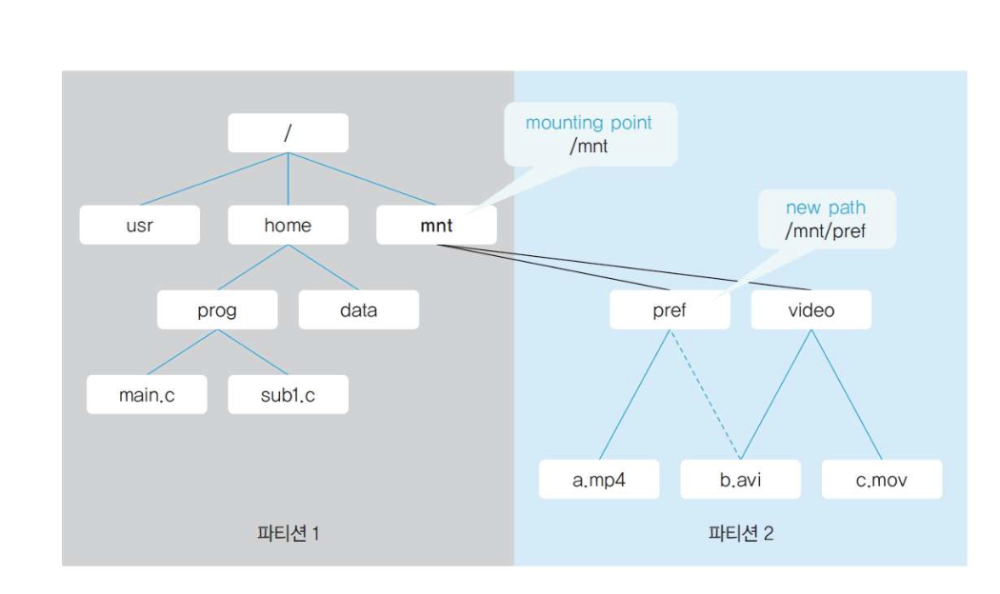
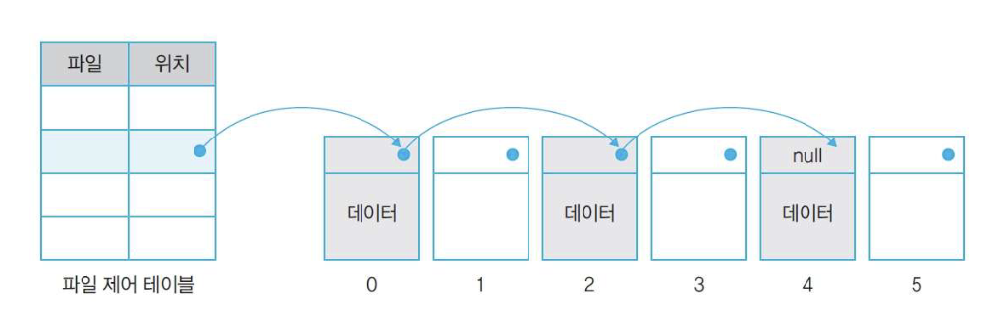
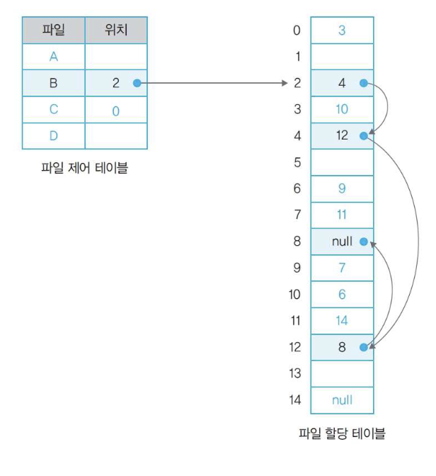
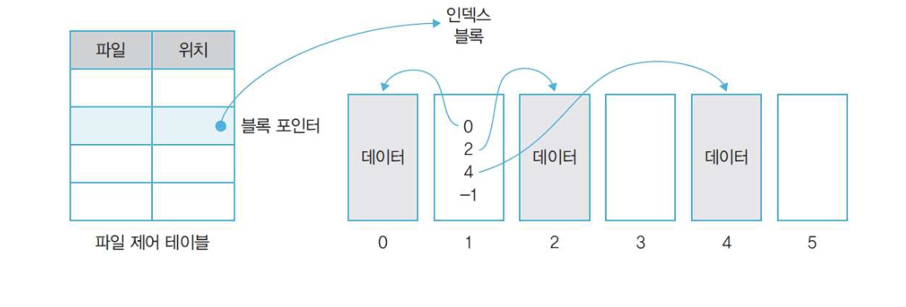
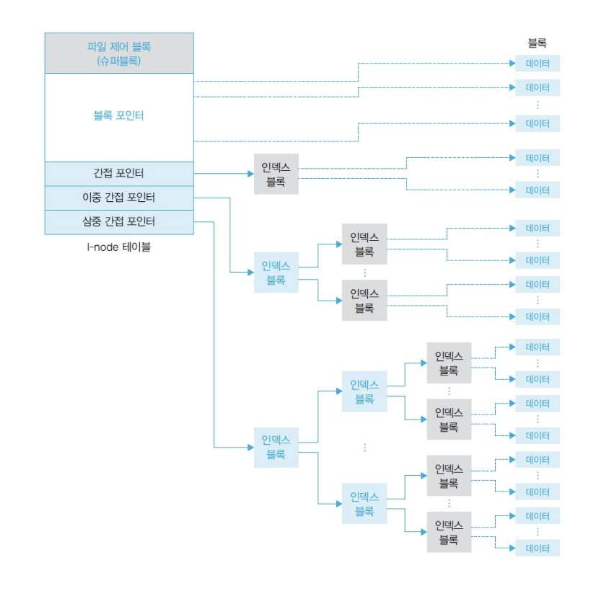

## 파일과 파일 시스템
### 파일 시스템의 개요
#### 파일 시스템의 개념
- 파일 시스템
	- 운영체제가 저장장치의 전체(저장, 검색, 읽기 등)를 관리하는 시스템. 
- 파일 관리자
	- 사용자의 요청에 따라 파일을 저장하거나 파일의 내용을 읽는다.
- 파일 테이블
	- 파일의 생성, 수정, 삭제 등을 수행하는데 사용
	- 파일에 대한 읽기, 쓰기, 실행과 같은 다양한 접근 방법 제공
- 파일 디스크립터
	- 사용자가 특정 파일에 접근하기 위해서 파일 관리자로부터 획득해야하는 권한(키)

#### 파일 시스템의 기능
- 운영체제별 파일 시스템
	- 원도우
		- FAT(File Allocation Table) => NTFS(New Technology File System)
	- 유닉스
		- Inode(Index node)
	- Apple
		- APFS(APple File System)
- 파일과 파일의 집합체인 디렉터리를 관리
	- 유닉스 - 디렉터리
	- 원도우 - 폴더

- 공통적으로 제공하는 기능

| 기능           | 설명                     |
| :----------- | :--------------------- |
| 파일 및 디렉터리 구성 | 파일과 디렉터리를 만듬           |
| 파일및 디렉터리 관리  | 생성, 수정, 삭제등을 관리        |
| 접근 방법 제공     | 읽고 쓰기 수행을 위한 접근 방법을 제공 |
| 접근 권한 관리     | 접근 권한을 관리              |
| 무결성 보장       | 파일이 손상되지 않도록 보장        |
| 백업과 복구       | 백업과 복구 작업              |
| 암호화          | 악의적인 접근으로부터 파일을 보호     |

> [!note]+ Inode 파일 시스템
> - inode를 중심으로 파일을 관리하는 유닉스 계열 파일 시스템 구조
> 	- inode: 파일의 크기, 소유자, 권한, 접근 시간, 하드링크수, 실제 데이터의 위치를 가르키는 포인터 등이 저장
> 	- 파일 하나에 대한 정보를 담아두는 자료구조

>[!note]+ FAT와 ExFAT의 차이점
>- ExFAT: FAT32의 한계를 극복하기 위해서 2006년에 출시
>
|구분|FAT (FAT32)|exFAT (Extended FAT)|NTFS|
|:---|:---|:---|:---|
|**개발 배경**|1996년(Windows 95 OSR2 등) 도입된 구형 방식|FAT32의 한계를 극복하기 위해 2006년 출시|FAT의 한계를 극복하고 **비즈니스 환경**에 맞는 고성능·고안정성 시스템 구축|
|**단일 파일 최대 크기**|**4GB** 제한|사실상 **무제한** (16Exbibyte까지 지원)|사실상 **무제한** (16Exbibyte까지 지원)|
|**최대 드라이브(파티션) 크기**|이론상 2TB (윈도우 기본 포맷 시 32GB 제한)|사실상 **무제한** (128Petabyte 지원-클러스터 32MB)|8Petabyte 지원(클러스터 크기 8MB)|
|특징|거의 모든 기기 지원|최신 기기 대부분에서 지원|저널링과 권한, 암호화, 압축 지원|
>|주 용도|구형 기기 호환|대용량 이동식 저장장치|Windows 시스템 드라이브|

>[!note]+ 저널링이란?
>- 파일 시스템이 디스크에 실제로 변경을 가하기 전에, 기록(저널, 로그)을 먼저 별도 공간에 남겨두는 방식
>	- 비정상적으로 꺼지거나 연결이 해제되는 경우 저널을 통해서 파일 시스템의 손상을 막아줌
>	- 파일의 손상은 막을 수 없음

#### 블록과 파일 테이블
- 하드디스크는 수 TB이므로 바이드 단위로 주소를 부여하면 매우 큰 주소 체계가 필요함
- 1B 크기인 파일이 많지 않기 때문에 더 큰 단위를 사용함

##### 블록
- 파일을 일정 정키로 묶어서 관리하는 단위
- 저장 장치에서 사용하는 가장 작은 단위
- 한 블록에 주소 하나가 할당됨
- 운영체제와 저장장치 사이에서는 파일을 블록 단위로 전송함

##### 파일 테이블
- 각 파일이 어떤 블록에 저장되어 있는지에 대한 정보를 저장하는 자료구조

### 파일
- 모든 파일은 0과 1의 비트 패턴으로 이루어짐
- 운영체제 입장에서는 크게 실행 파일과 데이터 파일로 나누어짐
#### 파일 종류와 확장자
##### 실행 파일
- 운영체제가 메모리로 가져와 CPU를 이용하여 작업하는 파일
	- 사용자의 요처으로 프로세스가 되는 파일
##### 데이터 파일
- 실행 파일을 작업하는데 필요한 데이터를 모아놓은 파일
	- 스스로 프로세스가 될 수 없고 운영체제가 전송하거나 보관만 할 뿐 특별하게 다루지 않는다.

##### 주로 사용하는 확장자
| 파일       | 확장자                      | 설명                  |
| -------- | ------------------------ | ------------------- |
| 실행 파일    | exe, com                 | 유닉스에는 실행 파일 확장자가 없음 |
| 소스코드 파일  | c, cpp, pas, a, java     | 다양한 소스코드의 확장자       |
| 라이브러리 파일 | lib, a, dll              | 소스코드를 위한 라이브러리의 확장자 |
| 배치 파일    | bat, sh, csh             | 초기 배치 파일의 확장자       |
| 문서 파일    | txt, doc, hwp, pdf, ps 등 | 문서 데이터 파일의 확장자      |
| 동영상 파일   | avi, asf, mkv, mov, rmv  | 동영상 데이터 파일의 확장자     |
| 음악 파일    | wav, mp3, ogg, flc, aac  | 음악 데이터 파일의 확장자      |
| 이미지 파일   | bmp, gif, jpg, png, webp | 이미지 데이터 파일의 확장자     |
| 압축 파일    | rar, zip, arc, al        | 압축 파일의 확장자          |

#### 파일 이름
- 파일 이름은 '파일 이름. 확장자'로 구성됨
- 초창기는 파일이름은 8자, 확장자는 3자로 제한
- 마지막에 오는 마침표 다음 글자부터 확장자로 인식
- 파일 이름은 경로를 포함하여 최대 255자
- 유닉스는 대소문자를 구분함
	- 원도우는 구분하지 않음

#### 파일 연결 프로그램
- 실행 파일을 실행시 실행 파일이 되고 데이터 파일 실행시 해당 파일을 사용하는 응용 프로그램이 실행됨
	- 운영체제가 데이터 파일을 필용한 응용프로그램을 대신 실행시켜줌

#### 파일 속성
- 파일 속성은 각 파일 해더에 기록됨
- 운영체제는 이러한 파일 헤더를 파일 테이블에서 관리한다.

##### 파일 속성의 종류

| 속성            | 특징           |
| ------------- | ------------ |
| name          | 파일 이름        |
| type          | 파일 종류        |
| size          | 파일 크기        |
| time          | 파일에 대한 접근 시간 |
| location      | 파일 위치        |
| accessibility | 파일에 대한 접근 권한 |
| owner         | 파일 소유자       |
#### 파일 작업
- 파일을 지우거나 이름을 바꾸는 것 과 같이 파일을 변경하는 일
- 파일 연산(File Operation)이라고도 함

##### 파일 자체 변경
- 윈도우의 파일 탐색기에서 이루어지는 작업

| 작업     | 설명            |
| ------ | ------------- |
| open   | 파일을 연다.       |
| close  | 파일을 닫는다.      |
| create | 새로운 파일을 생성한다. |
| remove | 파일을 이동한다.     |
| copy   | 파일을 복사한다.     |
| rename | 파일 이름을 변경한다.  |
| list   | 파일을 나열한다.     |
| search | 파일을 찾는다.      |

##### 파일 내용 변경
- 프로세스 입장에서 수행하는 작업

| 작업       | 설명                |
| -------- | ----------------- |
| open()   | 파일을 연다.           |
| create() | 새로운 파일을 생성한다.     |
| close()  | 파일을 닫는다.          |
| read()   | 파일 내용을 읽는다.       |
| write()  | 파일에 새로운 내용을 쓴다.   |
| update() | 파일 내용 중 일부를 변경한다. |
| insert() | 파일에 새로운 내용을 추가한다. |
| delete() | 파일 내용 중 일부를 지운다.  |

#### 파일 헤더
- 파일 속성과 파일에게 필요한 정보를 정의하여 사용하기 위해서 기록
	- 파일의 버전 번호, 크기, 특수 정보 등등 응용 프로그램이 필요한 정보
- 파일 헤더와 파일 속성의 차이
	- 파일 속성은 모든 파일이 공통으로 적용됨
	- 파일 헤더는 파일의 종류마다 다름
- 파일 속성은 운영체제가 관리하는 파일 헤더
	- 파일의 외부에 존재함
	- 파일 헤더는 파일 내부에 존재함

### 저장장치 관리 기법
#### 파티션
- 디스크를 논리적으로 분할하는 작업
- 하나의 논리적 저장장치에는 하나의 파일 시스템이 탑재된다
	- 파일 시스템 마다 하나의 파일 테이블을 가진다.
#### 포멧
- 저장장치의 파일 시스템을 초기화 하는 작업
	- 파일 테이블이 없는 경우 생성
	- 파일 테이블이 있는 경우 초기화
- 포멧의 종류
	- **빠른 포멧**: 데이터는 그대로 둔채 파일 테이블만 초기화하는 방법
		- 복구 프로그램을 이용하여 모든 블록을 검사하여 파일 헤더를 찾아서 분석하면 파일을 복구할 수있음
	- 느린 포멧: 파일 테이블을 초기화 하고 모든 블럭의 모든 데이터를 0으로 초기화함
		- 불량섹터를 찾아줌 - 모든 곳에 0을 쓰고 읽어 보면 쓰기나 읽기를 실패하는 경우 불량 섹터임

- 포멧에서 블록의 크기를 설정할 수 있음
	- 너무 크면 내부 단편화가 발생할 수 있음
- Low Level Format: 공장초기화 - 파일 시스템, 파티션, 섹터, 트랙 정보까지 초기화
#### 조각모음
- 파일을 저장했다 지우기를 반복하면서 외부 단편화가 발생
	- 조각화 또는 단편화
- 조각이 너무 많으면 큰 파일이 여러 분산된 조각에 저장되면 읽기 성능이 떨어짐
- 반도체를 이용항 저장장치에는 수명이 있기 때문에 조각 모음을 자주하면 성능이 떨어진다
### 파일 구조
#### 순차 파일 구조
- 파일 내용이 하나의 긴 줄로 늘어선 형태
	- 대표적으로 카세트 테이프
- 원하는 위치로 가기 위해서는 앞으로 감거나 뒤로 감아서 움직여야함
	- 순차 접근 방식
- 초기 컴퓨터는 카세트 테이프에 데이터를 저장함

- 장점
	- 모든 데이터가 순서대로 기록 되기 때문에 저장공간에 낭비된는 부분이 없다
	- 구조가 단순하다
	- 순서대로 데이터를 읽거나 저장할 때 매우 빠르게 처리 된다
- 단점
	- 파일에 새로운 데이터를 삽입하거나 삭제 할 때 시간이 많이 걸린다
		- 중간에 데이터를 삽입하려면 데이터를 뒤로 밀어 공간을 확보해야 한다.
		- 중간에 데이터를 삭제하는 경우 데이터를 메우기 위해서 데이터를 당겨와야 한다.
	- 직접 접근이 어려워 순서대로 움직여야 한다.

#### 인덱스 파일 구조
- 순차 파일 구조로 저장되어 있고 각 순차 파일의 시작점에 블록 번호가 매겨지고 인덱스 테이블에서 시작 블록 번호를 관리함
	- 인덱스 테이블을 추가하여 순차 접근과 직접 접근이 가능함
- 디스크를 활용하는 저장장치 보급되면서 개발됨
- 인덱스 순차 접근(Indexed sequential access): 인덱스를 이요한 접근 방식
- ISAM(Index Sequential Access Method): 인덱스 순차 접근으로 구성된 파일

- 장점
	- 여러 개의 인덱스 테이블을 만들면 다양한 접근이 가능함

#### 직접 파일 구조
- 저장하려는 데이터의 특정 값에 어떤 관계를 정의하여 물리적인 주소로 바로 변환하는 파일 구조
	- 해쉬 테이블
- 해쉬 함수로 직접 접근이 가능하다

- 장점
	- 해쉬 함수를 이용하여 주소를 변환 하기 때문에 데이터 접근이 매우 빠르다
- 단점
	- 해쉬 함수의 선정이 중요함
		- 전체 데이터가 고르게 저장 될 수 있도는 해쉬 함수를 찾기 어려움
	- 비 저장공간으로 인해 이용 효율이 떨어진다.

## 디렉터리의 구조
### 디렉터리의 개념
- 관련있는 파일을 묶어서 체계적으로 관리하기 위해 존재
- 1개 이상의 자식 디렉터리와 1개 이상의 파일을 가질 수 있음
- 루트 디렉터리(root): 최상위 디렉터리
	- (`/`)로 표현

### 디렉터리 파일
- 디렉터리도 파일이다
	- 파일 정보가 담겨있는 파일
- 일반 파일과 동일하게 해더가 존재함
	- 이름, 만든 시간, 접근 권한등의 정보가 기록되어 있음
- 디렉터리 헤더는 디렉터리 정보가 시작되는 위치를 가리킨다.
- `.`: 자신의 디렉터리를 가르킴
- `..`: 상위 디렉터리를 가르킴
	- 루트 디렉토리보다 상위 디렉터리가 없기 때문에 스스로 가르킴

### 경로
- 파일이 전체 디렉터리중 어디에 있는지를 나타내는 정보
- 절대 경로(absolute path):루트 디렉터리에서 시작하는 절대적인 위치를 의미
- 상대 경로 (relative path): 현재 위치를 기준으로 파일의 위치를 의미

### 디렉터리 구조
##### 1단계 구조
- 초기 디렉터리 구조
- 루트 디렉토리 밑에만 디렉토리를 만들 수 있음
- 하위 디렉터리에는 만들 수 없음
- 파일이 많지 않았음
##### 다단계 구조
- 루트 디렉터리를 시작점으로 여러 단계의 디렉터리가 존재하는 구조
- 트리 디렉터리 구조라고도 함
	- `바로가기`나 `링크`와 같은 구조가 생기면 그래프 구조로 변경됨
- 단계 확장에 제한이 없고  디렉터리에 파일과 디렉터리를 둘 다 저장 할 수 있음

### 마운트
- 하나의 파일 테이블에 여러 개의 파티션을 붙여서 사용하기 위해서 통합하는 명령어
	- 2개의 파티션은 하나의 파일 시스템으로 운영할 수 있다.

## 디스크 파일 할당
### 할당 방식
#### 연속 할당과 불연속 할당
- 파일 시스테은 기본적으로 메인 메모리 시스템과 유사하다
- 전체 디스크 공간을 같은 크기로 나누고 각 공간에 주소를 붙여서 관리한다.

- 파일 시스템은 파일의 이름과 해당 파일이 시작되는 블록 주소를 가진 파일 테이블을 관리한다
- 파일을 읽는 과정
	- 파일 관리자에게 요청
	- 파일 관리자가 파일 테이블에서 파일의 시작 블록 주소를 확인하고 전달
- 파일 테이블은 파티션당 하나씩 존재하며 각 파티션의 맨 앞부분에 위치한다.

- 파일은 여러 개를 사용하는데 여러 개의 블럭을 어떻게 연결하는에 따라 구분됨
	- 연속 할당(contiguous allocation)
		- 파일을 구성하는 데이터를 디스크상에 연속적으로 배열하는 방식
		- 시작 블럭만 알면 전체 파일을 찾을 수 있다.
		- 저장과 삭제가 반복되면 단편화가 발생한다
	- 불연속 할당 (non-contiguous allocation)
		- 비어 있는 블록에 데이터를 분산하여 저장하고 이에 관한 정보를 파일 시스템이 관리하는 방식
		- 연결 리스트를 이용한 할당과 인덱스를 이용한 할당이 있음
### 불연속 할당
#### 연결 할당
- 파일에 속한 데이터를 연결 리스트로 관리하는 방식
- 파일 테이블에는 시작 블록에 대한 정보만 저장하고, 나머지 데이터는 시작 블록부터 연결하여 저장한다.
	- 파일의 맨 끝에 해당하는 블록에는 링크 대신 널을 삽입한다.
- 체인 할당(chained allocation)이라고도 한다.
- 파일 할당 테이블을 이용하여 관리
- 원도우의 FAT가 사용한 방식
	- 파티션 전체 블록에 대한 정보를 가진 테이블로, 열의 개수가 그 파티션에 존재하는 블럭의 개수와 같다.
	- 각 파일을 구성하는 데이터가 어떤 블록에 연결되어 있는지를 나타내는 블록번호가 있다.
	- 버전에 따라 최대 주소의 크기를 나타낸다. FAT16 = 216, FAT32 = 232
- 단점
	- 하나의 파티션이 사용할 수 있는 디스크 용량이 테이블의 주소 크기로 제한된다
		- FAT16의 경우 최대 파티션의 크기가 32GB로 제한된다.

#### 인덱스 할당
- 연결 리스트를 활용한 할당 방식은 구현하기 쉽지만 최대 할당 크기의 제한이 있음
	- 이 문제를 해결하기 위해 이덱스를 이용한 인덱스 할당 방식을 사용
- 인덱스 할당 방식에서는 테이블의 블록 포인터가 데이터 블록을 연결하는 것이 아닌 데이터의 인덱스를 담고 있는 인덱스 블록을 연결한다
- 인덱스 블록은 실제 데이터의 위치에 관한 정보를 순서대로 보관
	- 파일의 끝은 -1(null)로 표시
- 테이블이 차 더 이상 데이터를 연결할 수 없을 때 인덱스스 블록을 연결하는 간접 인덱스 블록으 만들면 테이블을 무한히 확장할 수 있다
- 유닉스의 inode 파일 시스템이 대표적이다

##### I-node 시스템의 구조
- **파일 제어 블록**: 파일 소유자와 각종 속성을 나타낸다. 파일에 대한 모든 권한 정보를 포함하고 있기 때문에 슈퍼 블록이라고도 불린다.
- **블록 포인터**: 데이터가 있는 블록의 위치를 직접 연결하는 포인터
- **간접 포인터**: 크기가 작은 파일은 직접 연결된 블록 포인터로 빠르게 접근할 수 있다. 파일 크기가 블록 포인터가 다 차면 인덱스 블록을 생성하고  간접 포인터를 생성하여 인덱스 블록을 연결한다.
- **이중/삼중 간접 포인터**: 인덱스 블록 하나당 256개의 블록을 지정할 수 있다. 파일의 크기가 커서 인덱스 블록 하나로도 다 연결 할 수 없을 대 이중 간접 포인터를 사용하고 이보다 더 큰 경우 삼중 간접 포인터를 사용할 수 있다.

- 요약
	- 파일 크기가 작은 경우 블록을 직접 연결하여 빠르게 접근하고, 파일의 크기가 큰 경우 인덱스 블록과 이를 연결하는 간접 포이넡를 이용하여 확장한다.

### 빈 공간 관리
- 디스크에 파일을 저장할 때 모든 테이블을 뒤져서 빈 공간을 찾는 것은 비효율적이다.
- 빈 공간 리스트(Free Block List)
	- 파일 시스템에 빈 블록의 정보만 모아서 관리
	- 디스크의 내부 단편화를 줄이고 빈 공간을 효율적으로 사용하기 위함
- 실제 데이터를 지우지 않고 빈 공간 리스트에 등록하여 삭제로 간주
- 먼저 리스트에 들어온 블록부터 할당
	- 나중에 들어온 블록부터 할당하는 경우 디스크의 특정 섹터만 계속 사용하는 문제 발생
	- 디스크 복구하 휴지동에서 삭제한 파일을 되살리는 일이 가능
- 빈 공간이 빈 공간 리스트에 등록되지 않거나 데이터가 저장되었는데 블록 포인터가 사라지는 경우 해당 블록을 사용할 수 없는 문제가 발생함
	- 운영체제의 명령어를 이용하여 복구를 요청할 수 있다.

## 유닉스 파일의 특징
- 유닉스는 접근 패턴에 따라 파일을 구분함
	- r - read
	- w - write
	- x - execute
- 소유자, 소유자한 속한 그룹, 제 삼자에 따라 다른 접근 패턴을 가질 수 있다
- 유닉스는 x 접근 패턴에 따라 있으면 실행 파일을 구분한다.