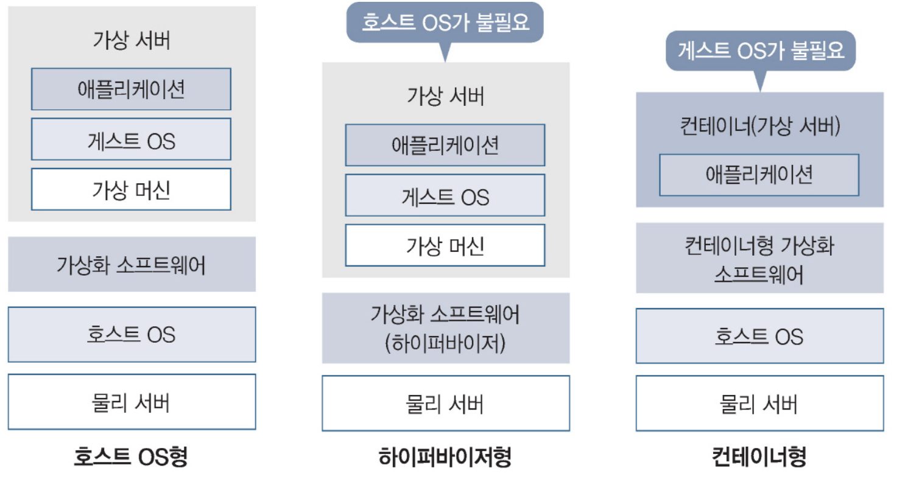
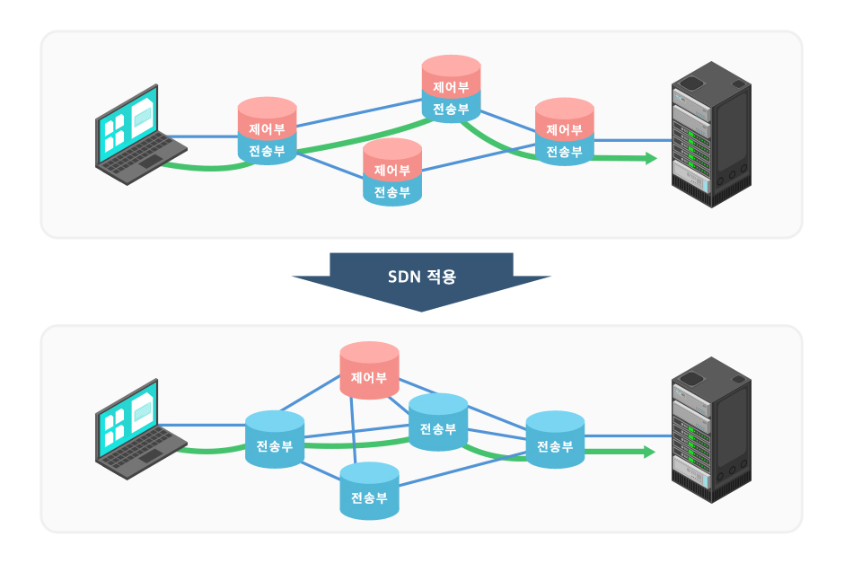

## 서버 가상화의 원리: 물리서버에 여러 대의 가상 서버를 구축한다.
### 서버 가상화란
- 하나의 물리 서버에 여러 대의 가상 서버를 구축하는 기술

#### 서버 가상화 종류

##### 호스트 OS형
- 물리 서버에 OS가 설치되어 가상 서버를 실행하는 기술
- 가상 서버는 물리 서버와 다른 게스트 OS를 가진다.
##### 하이퍼바이저형
- 물리 서버의 별도의 OS가 아닌 하이퍼바이저라는 가상 환경 관리 소프트웨어를 통해서 가상 서버를 실행시키는 기술
- 가상 서버는 별도의 게스트 OS를 가진다.
##### 컨테이너형
- '컨테이너'라는 애플리케이션과 실행 환경을 같이 분리하는 방식으로 애플리케이션 단위로 가상화하는 기술
- 가상 서버는 별도의 게스트 OS를 실행할 필요가 없다.
- 하나의 컨테이너에 하나의 애플리케이션을 단위로 구축

## 클라우드 서버 가상화:
### 아마존 EC2(Elastic Compute Cloud)
- 하이퍼바이저형 가상화
- 사용 목적에 따라 인스턴스 유형을 선택
### GCP GCE(Google Compute Engine)
- 인스턴스마다 가상 CPU의 수나 가상 메모리의 크기를 지정하여 사용
### Azure 가상 머신(VM, Virtual Machines)
- 사용 목적에 따른 시리즈를 선택

## 네트워크 가상화의 원리: 물리적 구성과 다른 논리적 네트워크를 구성한다.
### 네트워크 가상화란
- 물리적 네트워크 구성과 다르게 논리적 네트워크 구성을 나타내는 기술
	- 물리적으로 나누어진 네트워크를 하나의 네트워크처럼 나타내거나 하나의 물리적 네트워크를 여러 개의 분리된 네트워크로 나타낼 수 있음

### 네트워크 가상화의 기술

| 기술        | 가상화 대상   | 핵심                                   |
| --------- | -------- | ------------------------------------ |
| VLAN      | LAN (L2) | 스위치 포트·태그로 LAN을 논리적으로 분할             |
| 오버레이 네트워크 | L2/L3    | 터널링으로 물리 네트워크 위에 가상 네트워크 구성 (VXLAN) |
| VPN       | WAN      | 공용 회선 위에 암호화된 가상 전용선                 |
| SDN       | 네트워크 제어  | 제어 기능을 분리해 소프트웨어로 중앙 제어              |
| NFV       | 네트워크 기기  | 라우터·방화벽 기능을 범용 서버의 소프트웨어로 구현        |
| SD-WAN    | 거점 간 WAN | SDN 개념을 WAN에 적용해 중앙 관리              |

#### VLAN(Virtual LAN)
- 물리적 네트워크를 분할해 여러 논리 네트워크를 구축하는 기술
- 하나의 LAN 환경을 여러 개의 LAN 환경으로 구분하는 기술

##### 포트 VLAN - 단독 스위치
- 포트별로 그룹화하여 다른 그룹 간 통신을 불가능하도록 하는 방식

##### 태그 VLAN - 멀티 스위치
- `태그`라는 식별자를 이용하여 동일한 태그를 가진 그룹 간 데이터 송수신을 지원

#### 오버레이 네트워크
- 물리 네트워크 위에 독립적인 논리 네트워크를 만드는 기술이다.
	- 주로 클라우드와 같은 대규모 가상 서버로 구성된 네트워크 구축에 사용
- 주로 가상 스위치를 터널링으로 묶는 방식으로 구현

##### 터널링이란
- 패킷을 다른 패킷으로 덧씌워서 전송하는 방식
- 물리적 네트워크 구성의 영향을 받지 않도록 하기 위해 사용

#### VPN
- 공용 네트워크 위에 가상 사설망을 구축하는 기술
	- 주로 암호화된 터널링을 이용하여 구축

##### 사용 프로토콜
| 프로토콜      | 동작 계층  | 캡슐화 방식     | 특징                                        |
| --------- | ------ | ---------- | ----------------------------------------- |
| IPsec     | 커널(L3) | ESP 또는 UDP | 표준이라 장비 호환성이 높고 사이트 간 VPN에 많이 쓰임. 설정이 복잡함 |
| WireGuard | 커널(L3) | UDP        | 코드가 작고 빠르며 설정이 단순함                        |
| OpenVPN   | 유저 공간  | UDP 또는 TCP | TLS 기반이라 유연하고 방화벽 통과가 쉬움. 상대적으로 느림        |

#### SDN (Software Defined Network)

- 소프트웨어로 네트워크를 정의하는 기술
	- 네트워크의 구성을 소프트웨어로 관리
- 소프트웨어를 이용하여 일관된 관리를 할 수 있도록 하여 네트워크 가상화의 필수적인 기술이다.
##### OpenFlow
- SDN을 구현한 오픈 소스
- 네트워크 기기의 설정을 각 네트워크 기기에 직접 실시하는 것이 아닌 일괄로 기기를 설정할 수 있도록 함

#### NFV(Network Functions Virtualization)
- 네트워크 장치의 기능을 가상 환경의 소프트웨어로 구현하는 기술
	- 방화벽이나 라우터, 로드밸런서, NAT 같은 네트워크 기기의 기능을 범용 서버의 소프트웨어로 변환해주는 기술
- SDN은 트래픽 전달을 설정하고 NFV는 트래픽을 처리하는 기능들을 구현하고 설정함

##### NFV를 구성하는 아키텍처
- **VNF (Virtual Network Function)**
	- 가상화된 네트워크 장비
- **NFVI (NFV Infrastructure)**
	- NFV를 구성하기 위한 물리적 리소스
- **NFV MANO (NFV Management and Orchestration)**
	- VNF와 NFVI를 제어
		- 다수의 소프트웨어나 장비를 통합적으로 제어할 수 있도록 함

#### SD-WAN
- WAN을 소프트웨어로 가상화하고 중앙에서 관리할 수 있도록 하는 기술
- CPE(Customer Premises Equipment) 간 네트워크를 구축하고 관리할 수 있도록 함
- 제로 터치 프로비저닝
	- 인터넷을 통해서 자동으로 설정함

### 클라우드의 네트워크 가상화
#### 아마존 VPC (Virtual Private Cloud)
- 논리적으로 분할된 네트워크를 구축할 수 있다.

#### GCP VPC(Virtual Private Cloud)
- 아마존과 동일하게 가상의 네트워크를 구축할 수 있다.

#### Azure 가상 네트워크(Virtual Network)
- 가상의 네트워크를 구축
- 서브넷 사이의 트래픽 전체를 조절할 수 있다. 